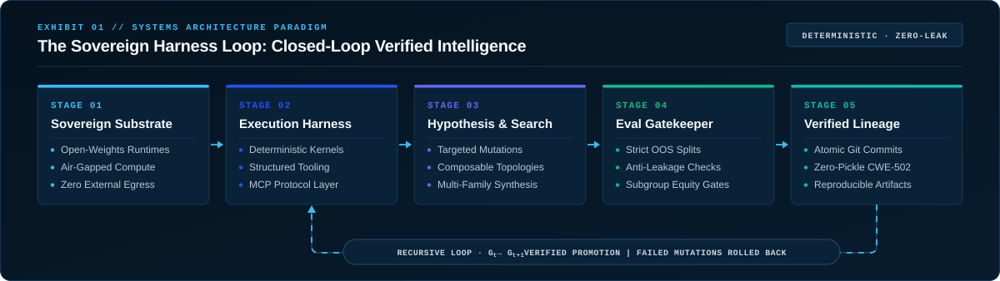

<picture>
  <source media="(prefers-color-scheme: dark)" srcset="assets/hero-dark.svg">
  <source media="(prefers-color-scheme: light)" srcset="assets/hero-light.svg">
  
</picture>

 

  
  &nbsp;
  
  &nbsp;
  

  <a href="#systems-thesis"><strong>Systems Thesis</strong></a>
  &nbsp;&middot;&nbsp;
  <a href="#the-sovereign-harness-paradigm"><strong>Architecture</strong></a>
  &nbsp;&middot;&nbsp;
  <a href="#core-architectural-pillars"><strong>Governing Principles</strong></a>
  &nbsp;&middot;&nbsp;
  <a href="#empirical-benchmark"><strong>Empirical Benchmark</strong></a>

---

## Systems Thesis

> **Frontier AI capability is rarely bottlenecked by model weights alone—it is governed by the deterministic harness, verification boundaries, and execution sovereignty wrapped around them.**

I design and study **sovereign, local-first AI architectures**, **neuro-symbolic execution harnesses**, and **closed-loop recursive self-improvement systems**. The governing principle is discipline over black-box generation: every autonomous step must be bounded by deterministic verification, strict out-of-sample gatekeeping, and transparent engineering lineage.

---

## The Sovereign Harness Paradigm

<picture>
  <source media="(prefers-color-scheme: dark)" srcset="assets/harness-loop-dark.svg">
  <source media="(prefers-color-scheme: light)" srcset="assets/harness-loop-light.svg">
  
</picture>

 

## Core Architectural Pillars

<picture>
  <source media="(prefers-color-scheme: dark)" srcset="assets/pillars-dark.svg">
  <source media="(prefers-color-scheme: light)" srcset="assets/pillars-light.svg">
  
</picture>

---

## Empirical Benchmark

Public repositories on this profile serve as **verifiable empirical benchmarks** of closed-loop autonomous engineering—prioritizing out-of-sample rigor, transparent commit-by-commit lineage, and auditable delivery over opaque outputs.

| Benchmark | Governing Principles Demonstrated |
| :--- | :--- |
| [**CIBMTR — Equity in Post-HCT Survival Predictions**](https://github.com/stefanoclss/CIBMTR-Equity-in-Post-HCT-Survival-Predictions) | Closed-loop autonomous evolution governed by strict out-of-sample validation integrity, subgroup equity awareness, atomic single-module Git lineage (`git log -p`), and verifiable zero-pickle delivery. |

---

<picture>
  <source media="(prefers-color-scheme: dark)" srcset="assets/footer-dark.svg">
  <source media="(prefers-color-scheme: light)" srcset="assets/footer-light.svg">
  
</picture>
