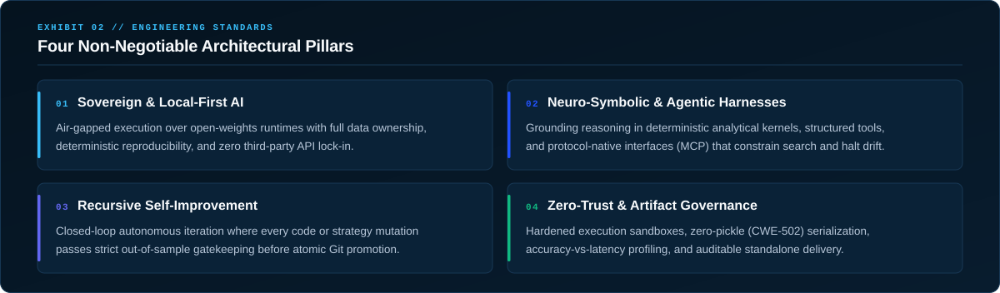

<picture>
  <source media="(prefers-color-scheme: dark)" srcset="assets/hero-dark.svg">
  <source media="(prefers-color-scheme: light)" srcset="assets/hero-light.svg">
  
</picture>

 

  
  &nbsp;
  
  &nbsp;
  

  <a href="#executive-perspective"><strong>Executive Perspective</strong></a>
  &nbsp;&middot;&nbsp;
  <a href="#how-it-works"><strong>How It Works</strong></a>
  &nbsp;&middot;&nbsp;
  <a href="#core-principles"><strong>Core Principles</strong></a>
  &nbsp;&middot;&nbsp;
  <a href="#featured-case-studies"><strong>Featured Case Studies</strong></a>

---

## Executive Perspective

> **Lasting AI advantage does not come from larger models alone—it comes from the discipline, governance, and independence built around them.**

Organizations rarely struggle to build AI prototypes; they struggle to trust them in high-stakes decisions. My work focuses on **sovereign, self-improving AI systems** that remain fully within an organization's control—turning complex data into transparent, verifiable, and repeatable business value without sacrificing privacy, security, or accountability.

---

## How It Works

<picture>
  <source media="(prefers-color-scheme: dark)" srcset="assets/harness-loop-dark.svg">
  <source media="(prefers-color-scheme: light)" srcset="assets/harness-loop-light.svg">
  
</picture>

 

## Core Principles

<picture>
  <source media="(prefers-color-scheme: dark)" srcset="assets/pillars-dark.svg">
  <source media="(prefers-color-scheme: light)" srcset="assets/pillars-light.svg">
  
</picture>

---

## Featured Case Studies

Selected public case studies across distinct high-stakes domains demonstrating how autonomous AI systems can meet institutional standards for accuracy, fairness, transparency, and full auditability.

| Domain | Case Study | Executive Value & Governance Demonstrated |
| :--- | :--- | :--- |
| **Healthcare & Clinical Risk** | [**CIBMTR — Equity in Post-HCT Survival Predictions**](https://github.com/stefanoclss/CIBMTR-Equity-in-Post-HCT-Survival-Predictions) | Autonomous, step-by-step model improvement built for high-stakes clinical risk decisions—combining rigorous independent validation, fairness across patient populations, a complete change-by-change audit trail, and safe, portable deployment with zero vendor lock-in. |
| **Energy Markets & Smart Grids** | [**Enefit — Predict Energy Behavior of Prosumers**](https://github.com/stefanoclss/Enefit-Predict-Energy-Behavior-of-Prosumers) | Autonomous forecasting of distributed energy generation and consumption to reduce grid imbalance costs—built with disciplined incremental refinement, strict independent validation, full change traceability, and portable delivery. |
| **Energy & Subsurface Operations** | [**ROGII — Wellbore Geology Prediction**](https://github.com/stefanoclss/ROGII-Wellbore-Geology-Prediction) | Autonomous subsurface geology forecasting engineered for drilling and geosteering decisions—delivering disciplined incremental accuracy gains, strict independent validation, a complete change-by-change audit trail, and safe, portable deployment without vendor lock-in. |
| **Wearable IoT & Digital Health** | [**CMI — Detect Behavior with Sensor Data**](https://github.com/stefanoclss/CMI-Detect-Behavior-with-Sensor-Data) | Automated behavioral signal recognition from multi-sensor wearable telemetry—transforming continuous device streams into reliable, auditable clinical indicators under strict independent verification. |
| **Preventative Health Screening** | [**CMI — Problematic Internet Use**](https://github.com/stefanoclss/CMI-Problematic-Internet-Use) | Early behavioral risk stratification combining activity and assessment profiles—built for transparent, accountable decision support with full change-by-change auditability and zero vendor lock-in. |
| **Strategic AI & Policy Selection** | [**UM — Game-Playing Strength of MCTS Variants**](https://github.com/stefanoclss/UM-Game-Playing-Strength-of-MCTS-Variants) | Autonomous performance forecasting across competing decision-search strategies—enabling evidence-based policy selection across diverse environments with complete validation rigor and audit trails. |
| **Probabilistic Forecasting & Risk** | [**March Machine Learning Mania 2026**](https://github.com/stefanoclss/March-Machine-Learning-Mania-2026) | Calibrated outcome-probability forecasting across high-uncertainty matchups—emphasizing decision reliability under uncertainty, strict independent validation, full change-by-change traceability, and transparent, portable delivery. |
| **Life Sciences & Behavioral Analytics** | [**MABe — Mouse Behavior Detection**](https://github.com/stefanoclss/MABe-Mouse-Behavior-Detection) | Autonomous behavioral event detection from complex time-evolving observation streams—combining systematic iterative refinement, rigorous independent validation, transparent audit trails, and self-contained reproducible delivery. |

---

<picture>
  <source media="(prefers-color-scheme: dark)" srcset="assets/footer-dark.svg">
  <source media="(prefers-color-scheme: light)" srcset="assets/footer-light.svg">
  
</picture>
